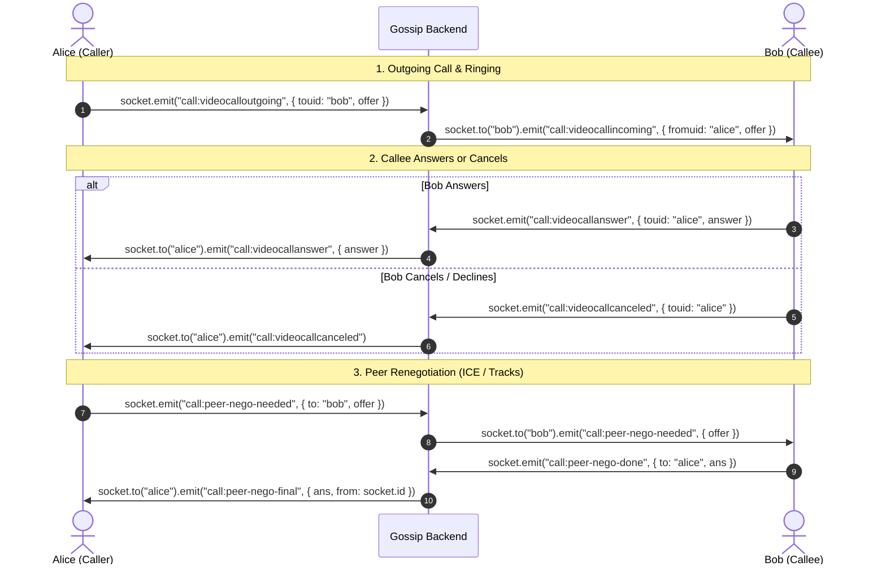

# Gossip Backend API & WebSocket Documentation

A reference guide for frontend developers integrating with the Gossip Backend. Covers all HTTP REST endpoints and Socket.IO real-time events, authentication protocols, request/response formats, and payload structures.

---

## Table of Contents
1. [Base Configuration & Authentication](#1-base-configuration--authentication)
2. [HTTP REST APIs](#2-http-rest-apis)
   - [Authentication Endpoints (`/api/auth`)](#authentication-endpoints-apiauth)
   - [Chat & Media Endpoints (`/api/chat`)](#chat--media-endpoints-apichat)
   - [User Search Endpoint (`/api/user`)](#user-search-endpoint-apiuser)
   - [AI Endpoints (`/api/ai`)](#ai-endpoints-apiai)
3. [Socket.IO Real-Time Events](#3-socketio-real-time-events)
   - [Handshake Authentication & Lifecycle](#handshake-authentication--lifecycle)
   - [Client-to-Server Events (`socket.emit`)](#client-to-server-events-socketemit)
   - [Server-to-Client Events (`socket.on`)](#server-to-client-events-socketon)
   - [WebRTC Signaling Flow](#webrtc-signaling-flow)

---

## 1. Base Configuration & Authentication

- **HTTP Base URL**: `http://localhost:5000`
- **Socket.IO URL**: `http://localhost:5000`

### HTTP Authentication
All protected REST endpoints require a JWT token in the `Authorization` header:
```http
Authorization: Bearer <your_jwt_authtoken>
```

### Socket.IO Authentication
Socket.IO uses **Handshake Authentication**. When connecting, supply the token in the `auth` object:
```javascript
import { io } from "socket.io-client";

const socket = io("http://localhost:5000", {
  auth: {
    token: "Bearer " + authtoken, // or raw authtoken
  },
});

socket.on("connect", () => {
  console.log("Connected to Gossip backend with ID:", socket.id);
});

socket.on("connect_error", (err) => {
  console.error("Connection failed:", err.message); // e.g. "Authentication error: Missing token"
});
```

> **Important**: The server authenticates your socket on handshake and **automatically** attaches your user session, joins your personal room (`uid`), broadcasts your online presence (`friendonline`) to friends, and syncs unseen messages. **There is no manual `user:connection` event required.**

---

## 2. HTTP REST APIs

### Authentication Endpoints (`/api/auth`)

#### 1. User Signup
- **Method**: `POST`
- **Route**: `/api/auth/signup`
- **Content-Type**: `multipart/form-data`
- **Body**:
  - `username` (string, required): Minimum 1 character.
  - `email` (string, required): Valid email address.
  - `password` (string, required): Minimum 8 characters.
  - `profile` (file, optional): Profile image file.
- **Success Response (200 OK)**:
  ```json
  {
    "data": {
      "authtoken": "eyJhbGciOiJIUzI1NiIsInR5cCI6..."
    },
    "user_id": "65a1234567890abcd1234efg",
    "message": "User registered successfully",
    "status": 200
  }
  ```

#### 2. User Signin
- **Method**: `POST`
- **Route**: `/api/auth/signin`
- **Content-Type**: `application/json` (or `multipart/form-data` with no file)
- **Body**:
  ```json
  {
    "email": "user@example.com",
    "password": "password123"
  }
  ```
- **Success Response (200 OK)**:
  ```json
  {
    "data": {
      "authtoken": "eyJhbGciOiJIUzI1NiIsInR5cCI6..."
    },
    "user_id": "65a1234567890abcd1234efg",
    "message": "User logged in successfully",
    "status": 200
  }
  ```

#### 3. Get Current User Profile
- **Method**: `POST`
- **Route**: `/api/auth/getuser`
- **Headers**: `Authorization: Bearer <token>`
- **Success Response (200 OK)**:
  ```json
  {
    "_id": "65a1234567890abcd1234efg",
    "uid": "a1b2c",
    "Username": "JohnDoe",
    "Email": "user@example.com",
    "ProfilePicture": "https://res.cloudinary.com/...",
    "settings": {
      "translation": {
        "language": "original",
        "alwaysTranslate": false
      },
      "summarization": {
        "format": "paragraph"
      }
    }
  }
  ```

#### 4. Send Email OTP
- **Method**: `POST`
- **Route**: `/api/auth/send-email-otp`
- **Content-Type**: `application/json`
- **Body**:
  ```json
  {
    "email": "user@example.com"
  }
  ```
- **Success Response (200 OK)**:
  ```json
  {
    "message": "OTP sent successfully to email",
    "status": 200
  }
  ```

---

### Chat & Media Endpoints (`/api/chat`)

#### 1. Upload Chat Image
Use this endpoint to upload images before sending them over the chat socket.
- **Method**: `POST`
- **Route**: `/api/chat/upload`
- **Headers**: `Authorization: Bearer <token>`
- **Content-Type**: `multipart/form-data`
- **Body**:
  - `image` (file, required): Image file (`image/jpeg`, `image/png`, `image/webp`, etc.)
- **Success Response (200 OK)**:
  ```json
  {
    "success": true,
    "url": "https://res.cloudinary.com/dppvlsjq1/image/upload/v1234567890/images/abc.jpg"
  }
  ```
> **Workflow**: Pass this returned `url` string in the `chat:sendmessage` socket event with `type: "image"`.

#### 2. Get Friends & Conversations
- **Method**: `POST`
- **Route**: `/api/chat/getFriends`
- **Headers**: `Authorization: Bearer <token>`
- **Success Response (200 OK)**:
  ```json
  {
    "msg": "ok",
    "friends": [
      {
        "uid": "x9y8z",
        "username": "JaneDoe",
        "profile": "https://res.cloudinary.com/...",
        "online": true
      }
    ],
    "chats": [
      {
        "_id": "67123...",
        "Sender_ID": "a1b2c",
        "Receiver_ID": "x9y8z",
        "text": "Hello Jane!",
        "type": "text",
        "seen": true,
        "translatedText": [],
        "createdAt": "2026-10-24T12:00:00.000Z"
      }
    ]
  }
  ```

---

### User Search Endpoint (`/api/user`)

#### Search Users
- **Method**: `GET`
- **Route**: `/api/user/search?q=<search_query>`
- **Headers**: `Authorization: Bearer <token>`
- **Query Parameters**:
  - `q` (string, required): Username, UID, or full name.
- **Success Response (200 OK)**:
  ```json
  {
    "msg": "ok",
    "users": [
      {
        "uid": "x9y8z",
        "Username": "JaneDoe",
        "ProfilePicture": "https://res.cloudinary.com/..."
      }
    ]
  }
  ```

---

### AI Endpoints (`/api/ai`)
Powered by Groq Cloud inference:
- **Vision Model**: `qwen/qwen3.8-27b`
- **Text Model**: `openai/gpt-oss-120b`

All `/api/ai/*` endpoints require `Authorization: Bearer <token>`.

#### 1. AI Conversational Chatbot
- **Method**: `POST`
- **Route**: `/api/ai/chatbot`
- **Headers**: `Authorization: Bearer <token>`
- **Body**:
  ```json
  {
    "message": "Can you give me tips on active listening?",
    "tone": "friendly",
    "history": [
      { "role": "user", "content": "Hi!" },
      { "role": "assistant", "content": "Hello there! How can I help you today?" }
    ]
  }
  ```
  - `tone` (optional): `"normal"` | `"friendly"` | `"formal"` | `"sarcastic"` | `"compassionate"` | `"humorous"`. Default: `"normal"`.
  - `history` (optional): Previous messages array.
- **Success Response (200 OK)**:
  ```json
  {
    "reply": "Active listening is all about being fully present...",
    "tone": "friendly"
  }
  ```

#### 2. Multimodal Image Analysis
- **Method**: `POST`
- **Route**: `/api/ai/analyze-image`
- **Headers**: `Authorization: Bearer <token>`
- **Body**:
  ```json
  {
    "url": "https://upload.wikimedia.org/wikipedia/commons/d/da/SF_From_Marin_Highlands3.jpg",
    "prompt": "Analyze this image and describe the scene."
  }
  ```
  - `url` (string, required): Public image URL or Base64 data URI (`data:image/jpeg;base64,...`).
  - `prompt` (string, optional): Custom instructions for the analysis.
- **Success Response (200 OK)**:
  ```json
  {
    "data": {
      "title": "Golden Gate Bridge and San Francisco Bay",
      "description": "A scenic view of the Golden Gate Bridge stretching across the bay with city skyline in the background.",
      "details": [
        "Orange suspension bridge structure",
        "Blue water with visible fog bank",
        "Clear sky with light haze"
      ],
      "mood": "Peaceful and majestic"
    }
  }
  ```

#### 3. Unified Message Translation
Translates single or multiple messages into any target language.
- **Method**: `POST`
- **Route**: `/api/ai/translate`
- **Headers**: `Authorization: Bearer <token>`
- **Body**:
  ```json
  {
    "messages": [
      { "id": "msg_001", "text": "Good morning, everyone!" },
      { "id": "msg_002", "text": "Are we meeting at 2 PM?" }
    ],
    "to": "spanish"
  }
  ```
- **Success Response (200 OK)**:
  ```json
  {
    "messages": [
      { "id": "msg_001", "translatedText": "¡Buenos días a todos!" },
      { "id": "msg_002", "translatedText": "¿Nos reunimos a las 2 PM?" }
    ],
    "language": "spanish"
  }
  ```

#### 4. Conversation Summarization
Summarizes a chat transcript into one of three formats.
- **Method**: `POST`
- **Route**: `/api/ai/summarize`
- **Headers**: `Authorization: Bearer <token>`
- **Body**:
  ```json
  {
    "conversation": [
      { "username": "Alice", "message": "Should we deploy the update tonight?" },
      { "username": "Bob", "message": "Better to do it tomorrow morning when the full team is online." },
      { "username": "Alice", "message": "Sounds good, 9 AM tomorrow it is." }
    ],
    "format": "bullet"
  }
  ```
  - `format` (optional): `"paragraph"` | `"bullet"` | `"structured"`. Default: `"paragraph"`.

- **Success Responses (200 OK)**:
  - If `format: "bullet"`:
    ```json
    {
      "summary": [
        "Alice proposed deploying the update tonight.",
        "Bob recommended waiting for tomorrow morning when the team is available.",
        "Team agreed to schedule deployment for 9 AM tomorrow."
      ]
    }
    ```
  - If `format: "paragraph"`:
    ```json
    {
      "summary": "Alice and Bob discussed deployment timing and decided to deploy tomorrow at 9 AM."
    }
    ```
  - If `format: "structured"`:
    ```json
    {
      "summary": {
        "topic": "Deployment Timing",
        "keyPoints": [
          "Evening deployment was considered.",
          "Morning deployment chosen to ensure team availability."
        ],
        "conclusion": "Deployment scheduled for tomorrow at 9 AM."
      }
    }
    ```

---

## 3. Socket.IO Real-Time Events

### Handshake Authentication & Lifecycle

When connecting:
```javascript
const socket = io("http://localhost:5000", {
  auth: {
    token: "Bearer " + authtoken,
  },
});
```

The server automatically:
1. Validates the JWT and fetches the user from the database.
2. Attaches `socket.data.uid` and user details.
3. Saves the active session in `UsersStore`.
4. Automatically joins the room named after your `uid`.
5. Emits `"friendonline"` with `{ uid: yourUid }` to your online friends.
6. Updates unseen incoming messages.

When disconnecting:
1. Automatically emits `"friendoffline"` with `{ uid: yourUid }` to online friends.
2. Removes the user from `UsersStore`.

---

### Client-to-Server Events (`socket.emit`)

#### 1. Send Message (`chat:sendmessage`)
Sends a text or image message to a recipient.
```javascript
// A. Sending a Text Message
socket.emit(
  "chat:sendmessage",
  {
    touid: "x9y8z",
    message: "Hey Jane! How are you?",
    type: "text"
  },
  (ack) => {
    if (ack) {
      console.log("Message delivered & saved:", ack);
    } else {
      console.error("Failed to send message");
    }
  }
);

// B. Sending an Image Message
// Step 1: Upload file to POST /api/chat/upload -> get { url }
// Step 2: Send URL over socket
socket.emit(
  "chat:sendmessage",
  {
    touid: "x9y8z",
    message: uploadedCloudinaryUrl,
    type: "image"
  },
  (ack) => {
    console.log("Image message saved:", ack);
  }
);
```

#### 2. Mark Messages as Seen (`chat:seenmessages`)
Marks conversation messages as read.
```javascript
socket.emit("chat:seenmessages", {
  fromuid: "x9y8z", // UID of the friend who sent the messages
  touid: "a1b2c"   // Your own UID
});
```

#### 3. Find User Online (`user:finduser`)
Looks up online users from in-memory session store.
```javascript
socket.emit("user:finduser", "Jane", (users) => {
  console.log("Matching online users:", users);
  // users: [{ uid, profile, username }]
});
```

#### 4. Send Friend Request (`user:sendchatrequest`)
```javascript
socket.emit("user:sendchatrequest", myUid, targetUid, (feedback) => {
  console.log("Feedback:", feedback); // "Request Sent" | "Your Already Friends" | "User not Online"
});
```

#### 5. Respond to Friend Request (`user:requestanswer`)
```javascript
socket.emit(
  "user:requestanswer",
  {
    tousername: "JaneDoe",
    fromuid: requesterUid,
    touid: myUid,
    answer: true // true = accept, false = reject
  },
  (feedback) => {
    console.log("Result:", feedback); // "You Accepted the Request" | "You Rejected the Request"
  }
);
```

#### 6. Change Translation Language (`settings:translate:languageChange`)
```javascript
socket.emit("settings:translate:languageChange", {
  language: "spanish" // or "french", "hindi", "original", etc.
});
```

#### 7. Change Always Translate Preference (`settings:translate:alwaysTranslateChange`)
```javascript
socket.emit("settings:translate:alwaysTranslateChange", {
  alwaysTranslate: true
});
```

#### 8. Change Summarization Format Preference (`settings:summarization:formatChange`)
```javascript
socket.emit("settings:summarization:formatChange", {
  format: "paragraph" // or "bullet_points"
});
```

---

### Server-to-Client Events (`socket.on`)

Listen for these events on the frontend:

#### 1. Receive Chat Message (`chat:receivemessage`)
Triggered when an incoming message is received.
```javascript
socket.on("chat:receivemessage", (chat) => {
  console.log("New message received:", chat);
  // chat: {
  //   _id: string,
  //   Sender_ID: string,
  //   Receiver_ID: string,
  //   text: string,
  //   type: "text" | "image",
  //   seen: boolean,
  //   translatedText: [{ language: string, translatedText: string }],
  //   createdAt: string
  // }
});
```

#### 2. Messages Seen Receipt (`seenmessages`)
Triggered when the other user views your sent messages.
```javascript
socket.on("seenmessages", ({ uid }) => {
  console.log("User has seen your messages:", uid);
});
```

#### 3. Friend Online Status (`friendonline`)
Triggered when one of your friends connects.
```javascript
socket.on("friendonline", ({ uid }) => {
  console.log("Friend came online:", uid);
});
```

#### 4. Friend Offline Status (`friendoffline`)
Triggered when one of your friends disconnects.
```javascript
socket.on("friendoffline", ({ uid }) => {
  console.log("Friend went offline:", uid);
});
```

#### 5. Incoming Friend Request (`requestfromuser`)
Triggered when someone sends you a friend request.
```javascript
socket.on("requestfromuser", ({ uid, profile, username }) => {
  console.log(`Friend request from ${username} (${uid})`);
});
```

#### 6. Friend Request Accepted (`successmessage`)
Triggered when the recipient accepts your friend request.
```javascript
socket.on("successmessage", ({ msg, user }) => {
  console.log(msg); // e.g. "Request Accepted by JaneDoe"
  console.log("Friend user details:", user);
});
```

#### 7. Friend Request Rejected (`errormessage`)
Triggered when the recipient rejects your friend request.
```javascript
socket.on("errormessage", (message) => {
  console.warn(message); // e.g. "Request Rejected by JaneDoe"
});
```

---

### WebRTC Signaling Flow

For audio and video calls, the backend acts as a low-latency WebRTC signaling relay between `fromuid` and `touid`.



#### Signaling Event Summary Table

| Client Emits (`socket.emit`) | Payload | Server Relays To Peer (`socket.on`) | Relay Payload |
| :--- | :--- | :--- | :--- |
| `call:videocalloutgoing` | `{ touid, offer }` | `call:videocallincoming` | `{ fromuid: senderUid, offer }` |
| `call:videocallanswer` | `{ touid, answer }` | `call:videocallanswer` | `{ answer }` |
| `call:videocallcanceled` | `{ touid }` | `call:videocallcanceled` | *(none)* |
| `call:audiocalloutgoing` | `{ touid, offer }` | `call:audiocallincoming` | `{ fromuid: senderUid, offer }` |
| `call:audiocallanswer` | `{ touid, answer }` | `call:audiocallanswer` | `{ answer }` |
| `call:audiocallcanceled` | `{ touid }` | `call:audiocallcanceled` | *(none)* |
| `call:peer-nego-needed` | `{ to, offer }` | `call:peer-nego-needed` | `{ offer }` |
| `call:peer-nego-done` | `{ to, ans }` | `call:peer-nego-final` | `{ ans, from: socket.id }` |
| `call:sendtracks` | `{ to }` | `call:requesttracks` | *(none)* |
